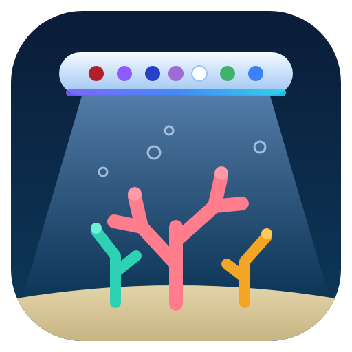

<p align="center"></p>

# Aqua Illumination for Home Assistant

Local, cloud-free control of **Aqua Illumination Prime** lights (verified on a
Prime 16, firmware 2.5.1) with a dashboard card. Wavemaker (Nero) support is
planned in the same repo — see [Roadmap](#roadmap).

> Unofficial. Not affiliated with Aqua Illumination / EcoTech Marine. The API
> was worked out from the myAI app and the community
> [AquaIPy](https://github.com/mcclown/AquaIPy) library (Apache-2.0).

## Install (HACS)
1. HACS → Integrations → ⋮ → Custom repositories → add this repo (category *Integration*).
2. Install, restart Home Assistant.
3. Settings → Devices & services → Add integration → **Aqua Illumination** → enter the light's IP.
   Give the light a DHCP reservation so the address never changes (if it does change, Home Assistant's DHCP discovery spots the light by its MAC prefix and updates the saved address automatically). For linked lights use the **parent**.

> HACS installs the latest **release**, not the branch — cut a release after changes.

## What you get (per light)
| Entity | |
|---|---|
| `number.<light>_<channel>` | each colour channel, 0–100 % |
| `switch.<light>_schedule` | the light's own schedule on/off |
| `switch.<light>_night_feeding` | manual mode, only red at 25 %; off restores the previous look and schedule |
| `switch.<light>_night_light` | a low glow on chosen channels over a night window, laid over the schedule (window/level/channels: `set_night_light` or the card). The schedule you edit stays separate, so editing it never loses the glow |
| `switch.<light>_all_lights` | **All lights on / off** for automations such as Feed and Water: off = every channel off; on = back to exactly what the light was doing (levels + schedule). Add it to Feed and Water's *Channel(s) to turn off while feeding* |
| `switch.<light>_lights_off` | lights off until switched back on, or for a set time (`lights_off` service); the previous look and schedule come back, even across a restart |
| `switch.<light>_lunar_cycle`, `time.<light>_lunar_start` / `_end` | lunar mode: during the window the schedule's levels are *reduced* by moon phase (it adds no light — give the schedule a low night level for a "moon") |
| `binary_sensor.<light>_connection` | dropout detection: on while the light answers; attributes `offline_since`, `last_seen`, `dropouts`, `last_outage_seconds`, `last_error`. Offline after 2 failed polls in a row (one miss is ignored); stays available during an outage so cards/automations can react |
| `select.<light>_schedule_preset` | built-in looks (Standard day, Coral growth, Acclimation) plus presets you saved; picking one rewrites the light's schedule |
| `sensor.<light>_moon_phase` | moon phase + illumination % (lunar mode dims the schedule's night levels by this) |
| `sensor.<light>_power_draw_estimated` | W, from channel levels x the light's rated per-channel wattage (only if the light reports it) |
| `sensor.<light>_stealth` | diagnostic: the light's stealth settings (enabled, dim, intensity %, suspend s); change with `set_stealth` |
| `sensor.<light>_temperature` | heatsink temperature (+ fan / thermal-shutdown attributes) |
| `sensor.<light>_schedule_data` | diagnostic; carries the ramps for the card |
| `sensor.<light>_device_clock`, `button.<light>_sync_clock`, `button.<light>_refresh` | clock tools |

Setting a channel **turns the light's schedule off** (as the vendor app does) — otherwise the
schedule overwrites your change within a minute. Turn the Schedule switch back on to resume.
The integration also keeps the light's clock right automatically (option).

## Card
When the light's schedule is switched off the card shows a red **"Schedule is OFF"** warning with a **Turn on** button (hidden while the lights are deliberately held off, a preview is running, or the light is offline), and after you save a schedule or apply a preset while it is off, it asks whether to turn it on - a saved schedule only plays when that switch is on.

The card is **view-only until you press Edit** (top right), so a stray tap can't change the light. It relocks after 2 idle minutes (never while an editor is open) or when you press **Done**. Options: `always_unlocked: true` removes the lock; `lock_seconds: 300` changes the idle time.
Registered automatically. Add to a dashboard:
```yaml
type: custom:aqua-illumination-card
entity: sensor.ai_prime_0a82_schedule_data   # your light's "Schedule data" sensor
```
When the light drops off the network the card shows an "offline for …" warning, greys out the controls, keeps the last schedule chart and reports dropout count/duration. **Edit schedule** opens the point designer: tap a time marker, set every channel's level with its sliders, drag the marker sideways (or type a time) to retime it, tap empty space to add a point, **Copy to all**, then **Save to light** or **Cancel**. With live preview on, the selected point shows on the real light. *Per-channel curves* switches to a per-channel point editor. A preset picker applies/saves looks, with **Export presets** / **Import…** to share them, **Night light…** for the glow layer, **Lights off…** for a timed hold, and a **Preview on light** slider in the editor that shows the draft on the real light before you save. Shows the 24 h schedule with a "now" marker, live sliders per channel, and Schedule /
Night feeding / Sync clock buttons.

## Follow the moon
In the card's **Night light** sheet, tick **Follow the moon**. The glow then switches on at the real **moonrise** and off at **moonset** (only inside your night hours, so it never lights the day), and its brightness follows the phase: your *Level at full moon* times how lit the moon is, never below *Never below* % of that. On a new moon, or any night the moon is down for the whole night, there is no glow. Moon times are calculated for your Home Assistant location (checked against the US Naval Observatory: moonrise/moonset within about 8 minutes, phase brightness within about 5 %) and refreshed daily at noon. While it's on, the light's own *Lunar cycle* is switched off (it would dim the glow a second time) and restored when you untick it. Built-in presets no longer bake a night glow into the day schedule by default (use the night light for that).

## Setup, options, dashboard
- **Add integration** offers *Enter the IP* or *Search my network* (scans your subnet for lights, or the networks you list). Lights that change address are re-found by DHCP discovery.
- **Options**: poll interval, automatic clock, and Night feeding **level** and **channels** (none ticked = the red channels).
- **Download diagnostics** from the device page (addresses and serials are redacted).
- **Dashboard**: `python dashboards/generate_dashboard.py ai_prime_0a82 --title "Reef lights" > aqua.yaml` writes a ready dashboard (card, controls, history) for one or more lights.
- The card has a visual editor (pick the light's *Schedule data* sensor).

## Services
- `aqua_illumination.set_channels` — `levels: {blue: 40, deep_blue: 60}` (percent)
- `aqua_illumination.set_schedule` — `ramps: [{color, points: [{time: minutes, intensity: 0-1000}]}]`
  (every channel needs a ramp; times strictly increasing 0–1440)
- `aqua_illumination.set_lunar` — `enable`, `start`, `end` (lunar window; reduces schedule levels by moon phase)
- `aqua_illumination.set_night_light` — any of `enable`, `start`, `end`, `level` (%), `channels`, `follow_moon`, `moon_min` (%)
- `aqua_illumination.lights_off` (`duration` minutes, blank = until resumed) / `cancel_lights_off`
- `aqua_illumination.preview_levels` — hold `levels` (%) for `duration` minutes (default 10), then the previous look returns. The card's editor uses it to preview a draft at any time of day
- `aqua_illumination.export_presets` (returns the saved presets as data) / `import_presets` (`data` = the exported text, `replace`)
- `aqua_illumination.set_stealth` — any of `enable`, `dim`, `intensity` (%), `suspend` (s)
- `aqua_illumination.sync_clock`
- `aqua_illumination.apply_preset` / `save_preset` / `delete_preset` — built-in or saved schedules (`save_preset` stores the light's current schedule)
- `aqua_illumination.copy_schedule` — `source` light's schedule onto other lights

Every service accepts a **list** of entities, so one call drives several lights (a failing light doesn't stop the others).

Events: `aqua_illumination_dropout` / `aqua_illumination_reconnected` fire when a light drops off the network or returns (payload: serial, name, host), and a persistent notification is raised until it is back.

All take an `entity_id` of any entity belonging to the light.

## Roadmap
- A card control for stealth (currently service + diagnostic sensor only; its exact behaviour on the light is untested).
- Wavemaker (Nero) cards in this repo, modelled on the Jebao pump cards. **Not started** — the app
  drives pumps through a separate "Director/Mobius" hub API (`/api/controller`, `/api/tanks`,
  `/api/groups`), and no pump hardware has been available to capture against.
- Storm / acclimation / stealth endpoints (not present on Prime 16 firmware 2.5.1 —
  `storm` and `acclimation` return 404 there).

## Status
Verified on real hardware: reads, channel writes, schedule read+write, schedule on/off, lunar mode, clock read/write.
**Not yet verified:** the HA entity layer on a running Home Assistant,
the card in a browser. See `CLAUDE.md`.

## Develop
```
python -m pytest -p no:socket -p no:homeassistant -q
```
